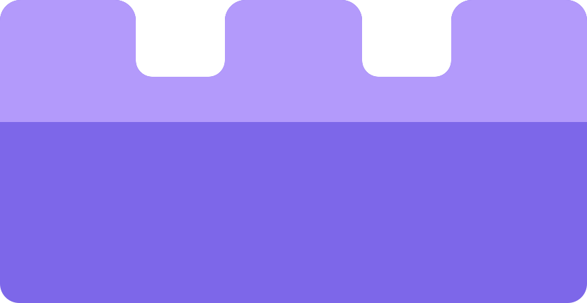
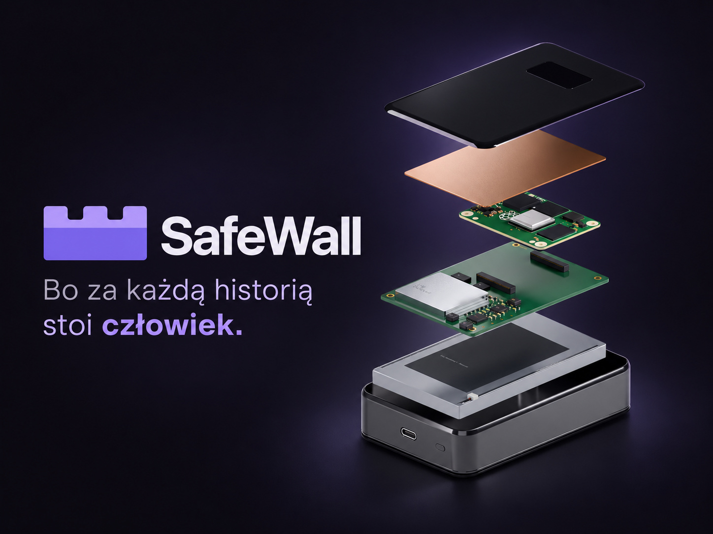
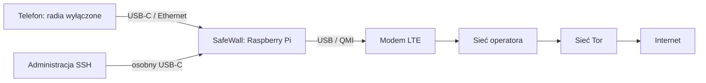

# SafeWall

**Bo za każdą historią stoi człowiek.**

Kieszonkowa brama prywatności: telefon po kablu, własne LTE i ochrona połączeń przez Tor. Projekt dla dziennikarzy, aktywistów i organizacji społecznych, rozwijany podczas hackathonu.

[Prezentacja dla jury](projekt/prezentacja/SafeWall-prezentacja.pdf) · [Opis projektu](projekt/Draft-projektu.md) · [Aktualny stan](docs/STATUS.md) · [Dokumentacja](docs/README.md)



Cover jest kompozycją AI na podstawie renderu Blendera. Obudowa przedstawia koncepcję produktu, a nie gotowy sprzęt produkcyjny.

## Uruchom dashboard lokalnie

Wymagany Node.js 20 lub nowszy. Dashboard nie wymaga instalowania pakietów:

```sh
cd dashboard
npm run dev
```

Otwórz **http://127.0.0.1:4173**. CSS odświeża się bez przeładowania; zmiana HTML/JS przeładowuje widok. Na macOS `npm run dev:safari` otwiera też Safari. Bez serwera można otworzyć gotowy `dashboard/Podglad.html`.

**Dashboard używa danych demo.** Nie odczytuje urządzenia i nie steruje ochroną. Tryb `?source=api` pokazuje brak odczytów, dopóki nie powstanie backend; nie zastępuje błędów sztucznymi danymi. `safewall.local` jest nazwą docelową, jeszcze nieskonfigurowaną dla dashboardu.

## Stan projektu — 4 października 2026

| Obszar | Co mamy | Co pozostaje |
| --- | --- | --- |
| Router | Raspberry Pi 4, PiTalk EG25-G, Ethernet telefonu, DHCP/DNS, nftables i administracja przez USB | Powtarzalne testy LTE; wcześniejsze pomiary wykazały timeouty i niski transfer |
| Tor | Użytkownik potwierdził działanie; nowsze nagranie pokazuje pozytywny wynik Tor Check | Zapis aktualnej konfiguracji Pi i testy DNS, IPv6, UDP oraz odcięcia po awarii. `config/` nadal zawiera wcześniejszy NAT |
| Dashboard | Cztery widoki, wykres ruchu, scenariusze awarii, kontrakt API, testy i podgląd offline | Kolektor rzeczywistych danych i wdrożenie na Pi |
| Sprzęt | Studium CAD, wariant B 110 × 70 × 24 mm, wizualizacja warstw i obudowy | Projekt PCB, dobór podzespołów, pomiary zasilania, temperatur i anten. 2 h to cel, nie wynik |
| Materiały | Logo 4A, cover, prezentacja PDF, źródło outro i montaż preview v22 | Publikacja filmu i finalny render premium; duże multimedia pozostają poza Gitem |

Pozytywny wynik strony w nagraniu nie potwierdza ochrony całego ruchu. Osobna `mock-check-tor/` to makieta i nie stanowi testu Tora. Szczegóły oraz pochodzenie informacji: [STATUS.md](docs/STATUS.md).

## Jak ma działać urządzenie



To docelowa droga obsługiwanego ruchu; klient Tor działa na bramie. Dostarczona konfiguracja routera nie odtwarza jeszcze całej tej ścieżki. Tryb chroniony ma zatrzymywać ruch po awarii Tora, zachowując dostęp do panelu.

## Zawartość repozytorium

- [dashboard/](dashboard/README.md) — aplikacja, umowa API, testy i serwer lokalny.
- [docs/](docs/README.md), [projekt/](projekt/README.md) — aktualny status, dokumentacja techniczna, draft i prezentacja.
- [config/](docs/KONFIGURACJA.md), [scripts/](scripts/README.md), `tests/` — baza routera, diagnostyka i testy Linux.
- [physical-design/](physical-design/README.md) — CAD koncepcyjny, skrypty Fusion/Blendera, pomiary geometrii i wybrane rendery.
- [brand/](brand/README.txt), [marketing/](marketing/README.md) — oficjalne logo, eksporty, cover, outro i dokumentacja filmu.

## Kontrola zmian

```sh
cd dashboard
npm run check
npm run build
npm test
```

Testy routera wymagają Linuxa, odpowiedniej konfiguracji i uprawnień root; nie uruchamiają się na Macu ani jako część testów dashboardu. [Zakres sprawdzeń](docs/KONFIGURACJA.md#testy).

## Granice ochrony

Modem nadal nadaje, a operator identyfikuje SIM i może ustalać jego położenie. Tor nie usuwa identyfikacji przez konta lub cechy przeglądarki. Filtr DNS nie blokuje całej telemetrii. Zwykłe SMS-y i rozmowy operatora nie przechodzą przez Tor i nie stają się E2EE dzięki routerowi.

Repozytorium nie zawiera kluczy, profili SIM, surowych logów ani kopii systemu. [Zasady publikacji i odtwarzania materiałów](docs/REPOZYTORIUM.md).
