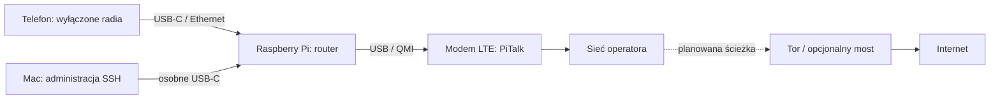

# SafeWall

**Kieszonkowa brama prywatności: telefon po kablu, własne LTE i planowana ochrona przez Tor.**

[Draft projektu — PDF (2 strony)](docs/SafeWall-draft.pdf) · [Opis projektu](docs/PROJEKT.md) · [Plan rozwoju](docs/PLAN.md) · [Konfiguracja prototypu](docs/KONFIGURACJA.md)

## Pomysł

Telefon łączy się z urządzeniem przez adapter USB-C–Ethernet. Użytkownik włącza tryb samolotowy i sprawdza wyłączenie Wi-Fi oraz Bluetooth. SafeWall ma zapewniać internet przez własny modem, kierować obsługiwany ruch przez Tor i pokazywać działanie filtrów w lokalnym panelu.

Tor w schemacie oznacza logiczną drogę ruchu; jego klient będzie działał na Raspberry Pi.

## Stan projektu

Prototyp ma konfigurację nftables, DHCP, DNS i routingu IPv4 oraz administrację SSH po osobnym USB-C. Potwierdzono przydzielenie adresu iPhone’owi i otwieranie stron przez LTE. Repozytorium zawiera kod tej bazy routera.

Tor, mosty, filtrowanie domen telemetrycznych, panel, SMS/rozmowy i miniaturyzacja są **planowane**. Obecne reguły zapewniają bezpośredni NAT do modemu — nie wdrażają Tora ani jego blokady awaryjnej. Pełny scenariusz telefonu w trybie samolotowym wymaga testu.

## Kolejne etapy

1. Integracja LTE i Tora z blokadą ruchu poza chronioną ścieżką.
2. Lokalny panel: stan sieci, statystyki blokad DNS i reguły filtrowania.
3. Obsługa SMS i rozmów; osobno komunikacja z szyfrowaniem od nadawcy do odbiorcy.
4. Własne zasilanie, płytka PCB i kompaktowa, dyskretna obudowa CAD.

## Granice ochrony

Modem nadal nadaje, a operator widzi SIM i może ustalać jego położenie. Tor nie usuwa identyfikacji przez konta ani cechy przeglądarki. Filtr DNS nie blokuje całej telemetrii. Zwykłe SMS-y i rozmowy operatora nie przechodzą przez Tor i nie stają się szyfrowane od nadawcy do odbiorcy dzięki routerowi.

## Zawartość

- `docs/` — draft dla komisji, plan i dokumentacja konfiguracji.
- `config/` — reguły zapory, DHCP/DNS, ustawienia systemowe i usługi.
- `scripts/` — aktualizacja interfejsu WAN i obsługa zapory.
- `tests/` — test routera w odizolowanych przestrzeniach sieciowych Linux.

Dokumentacja opisuje prototyp Raspberry Pi OS Lite 64-bit z NetworkManagerem. Repozytorium nie zawiera danych SIM, haseł, kluczy SSH, prywatnych logów ani kopii całego systemu. Instalacja nie odbywa się automatycznie po sklonowaniu.
