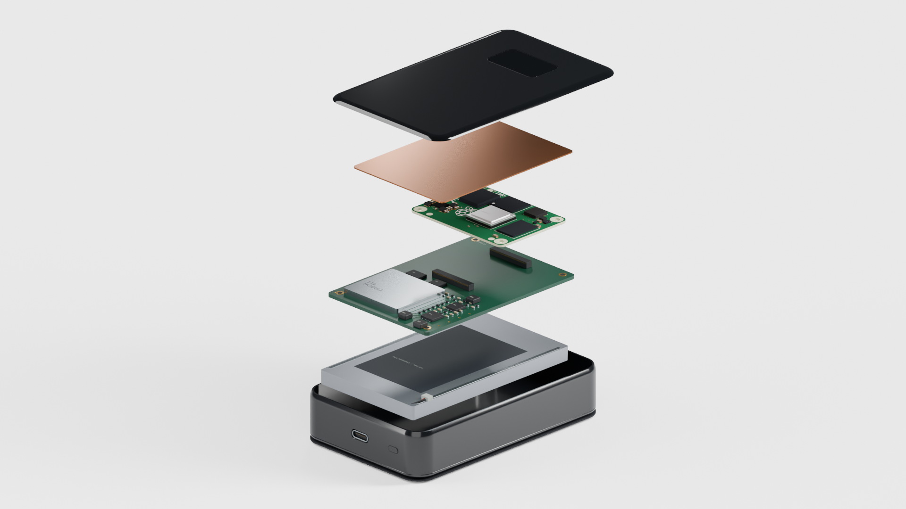

# Projekt konstrukcji i wizualizacja

To **studium koncepcyjne**, nie gotowy projekt produkcyjny. Własna PCB, dobór baterii i anten, bilans zasilania oraz próby cieplne pozostają do wykonania.

## Geometria

[Brief](design-brief.json) opisuje wymagania i niewiadome, [studium układu](layout-study.json) — parametry wejściowe, a [wyniki](layout-study-results.json) — wymiary, objętości i ograniczenia. [Porównanie A/B](layout-comparison.svg).

| Wariant | Obwiednia | Status |
| --- | --- | --- |
| A | 128 × 110 × 15 mm | Szeroki wariant porównawczy |
| B | 70 × 110 × 24 mm | Preferowany kierunek; w prezentacji zapisany jako długość × szerokość × grubość: 110 × 70 × 24 mm |

Masy z JSON dotyczą brył obudowy i podkładki, nie całego urządzenia. Szacunki czasu pracy zakładają sprawność i pobór mocy; **2 godziny to cel, nie pomiar**. Model OLED oraz przykładowe 87% są elementami wizualizacji. MagSafe oznacza mocowanie, nie bezprzewodowe ładowanie.

## Pliki do pracy

- `exports/` — własne koncepcje A/B w Fusion F3D i STEP, widok rozłożony, porównanie oraz OBJ/MTL. Jednostki importu opisuje `exports/import-notes.json`.
- `scripts/` — skrypty Fusion, budowania scen Blendera, renderowania, montażu i lektora. Fusion wymaga działającego środowiska `adsk`; klient `fusion_mcp.py` łączy się z lokalnym serwerem na porcie 27182.
- `visualization/` — plany, parametry, raporty i wybrane rendery. Premium v04 to wzorzec wyglądu produktu; najnowszy pełny montaż to v22.
- `references/` — opisy pochodzenia modeli oraz wybrane kadry dostarczonego nagrania potrzebne do prezentacji. Oryginały dużych modeli i filmów pozostają lokalnie.

Scena `Product-keynote-v04.blend` i szczegółowy `SafeWall-B-detailed-visual-v02.f3d` są w lokalnym archiwum, poza Gitem. Scenariusze filmu i historyczne skrypty odwołują się także do starszych lokalnych scen; sam checkout nie odtworzy całego filmu. [Zasady archiwum](../docs/REPOZYTORIUM.md).

Historyczne skrypty Fusion wykonywano przez MCP jako tekst z ustawioną ścieżką folderu roboczego. Przy przeniesieniu na inny komputer trzeba dopasować ścieżki tych skryptów oraz środowisko Fusion. Skrypty CLI z `Path(__file__)` rozwiązują ścieżki względem repozytorium. Nie uruchamiaj całego katalogu skryptów automatycznie: część zapisuje sceny lub zleca płatną generację lektora.

## Źródła zewnętrzne

Model CM4 pochodzi z Raspberry Pi Ltd; metadane i adres plików są w `references/cm4-official/source.json`, o ile zapisano je w lokalnym archiwum. Dokumentację oraz oryginalne pliki należy pobrać u dostawcy: https://pip.raspberrypi.com/categories/1204-design-files.

Model szafy serwerowej użyty jako ilustracja przekaźników: [Compute Rack, 3D Assets](references/server-rack-v21/README.txt), deklarowana przez autora licencja CC0; zapis pochodzenia w `source.json`. Trzy serwery w filmie są objaśnieniem, nie pomiarem obwodów Tora urządzenia.

Archiwalna referencja telefonu Apple oraz dokumenty mechaniczne dostawców nie są naszym projektem. W gotowej prezentacji użyto własnych renderów i kadrów dostarczonego nagrania. Oficjalny znak Tor ma źródło podane w `projekt/prezentacja/README.txt`; nie jest logo SafeWall.
